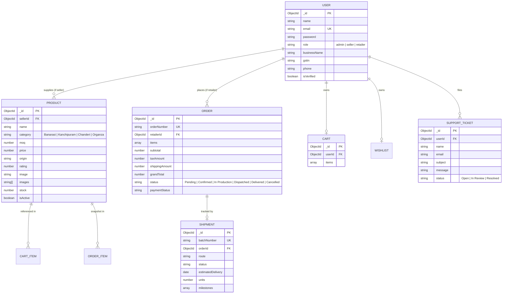

# Database Schema & Mongoose Data Models
## Pavitra B2B Saree E-commerce Platform

---

### 1. Database Architecture Overview
- **Database Engine:** MongoDB (via MongoDB Atlas)
- **Object Data Modeling (ODM):** Mongoose v8.x
- **Conventions:**
  - Collection names in lowercase plural (`users`, `products`, `orders`, `carts`, `wishlists`, `shipments`, `supporttickets`).
  - Strict typing and automatic timestamps (`createdAt`, `updatedAt`).
  - Embedded subdocuments for frozen snapshots (e.g. order items).
  - Explicit indexes on foreign keys, email, and searchable attributes.

---

### 2. Entity Relationship Diagram (Mermaid)



---

### 3. Detailed Mongoose Schema Specifications

#### 3.1 `User` Schema (`models/User.js`)
Represents Administrators, Retailer Buyers, and Weaver Sellers.

```javascript
import mongoose from 'mongoose';

const userSchema = new mongoose.Schema(
  {
    name: {
      type: String,
      required: [true, 'Contact or representative name is required'],
      trim: true,
      maxlength: 100
    },
    email: {
      type: String,
      required: [true, 'Email address is required'],
      unique: true,
      lowercase: true,
      trim: true,
      match: [/\S+@\S+\.\S+/, 'Please provide a valid email address']
    },
    password: {
      type: String,
      required: [true, 'Password is required'],
      minlength: 6,
      select: false // Do not return password by default
    },
    role: {
      type: String,
      enum: ['admin', 'seller', 'retailer'],
      default: 'retailer',
      required: true
    },
    businessName: {
      type: String,
      trim: true,
      default: ''
    },
    gstin: {
      type: String,
      trim: true,
      uppercase: true,
      default: '',
      match: [/^[0-9]{2}[A-Z]{5}[0-9]{4}[A-Z]{1}[1-9A-Z]{1}Z[0-9A-Z]{1}$|^$/, 'Invalid Indian GSTIN format']
    },
    phone: {
      type: String,
      trim: true,
      default: null
    },
    businessVerificationStatus: {
      type: String,
      enum: ['unverified', 'pending', 'verified', 'rejected'],
      default: 'unverified'
    },
    accountStatus: {
      type: String,
      enum: ['active', 'suspended', 'pending_approval'],
      default: 'active'
    }
  },
  {
    timestamps: true,
    toJSON: {
      transform: function (doc, ret) {
        delete ret.password;
        delete ret.__v;
        ret.id = ret._id;
        delete ret._id;
        return ret;
      }
    }
  }
);

// Indexes
userSchema.index({ email: 1 });
userSchema.index({ role: 1 });
userSchema.index({ businessVerificationStatus: 1 });
userSchema.index({ accountStatus: 1 });
```

---

#### 3.2 `Product` / Saree Schema (`models/Product.js`)
Stores wholesale handloom sarees directly mirroring the frontend catalog card shapes.

```javascript
import mongoose from 'mongoose';

const productSchema = new mongoose.Schema(
  {
    name: {
      type: String,
      required: [true, 'Saree title is required'],
      trim: true,
      maxlength: 200
    },
    slug: {
      type: String,
      unique: true,
      lowercase: true,
      trim: true,
      index: true
    },
    description: {
      type: String,
      trim: true,
      default: ''
    },
    category: {
      type: String,
      required: [true, 'Category is required'],
      enum: ['Banarasi', 'Kanchipuram', 'Chanderi', 'Organza', 'Silk', 'Cotton'],
      index: true
    },
    fabric: {
      type: String,
      trim: true,
      default: 'Silk'
    },
    moq: {
      type: Number,
      required: [true, 'Minimum order quantity is required'],
      min: [1, 'MOQ must be at least 1 piece'],
      default: 5
    },
    price: {
      type: Number,
      required: [true, 'Unit wholesale price in INR is required'],
      min: [1, 'Price must be positive']
    },
    origin: {
      type: String,
      required: [true, 'Weaver cluster/origin is required'],
      trim: true
    },
    rating: {
      type: Number,
      default: 4.8,
      min: 1.0,
      max: 5.0
    },
    reviewCount: {
      type: Number,
      default: 0,
      min: 0
    },
    image: {
      type: String,
      required: [true, 'Primary display image URL is required']
    },
    images: {
      type: [String],
      default: []
    },
    stock: {
      type: Number,
      required: true,
      default: 50,
      min: 0
    },
    seller: {
      type: mongoose.Schema.Types.ObjectId,
      ref: 'User',
      required: [true, 'Seller reference is required'],
      index: true
    },
    isActive: {
      type: Boolean,
      default: true,
      index: true
    }
  },
  {
    timestamps: true,
    toJSON: {
      virtuals: true,
      transform: function (doc, ret) {
        delete ret.__v;
        ret.id = ret._id;
        delete ret._id;
        return ret;
      }
    },
    toObject: { virtuals: true }
  }
);

// Virtual for formatted price matching frontend "₹4,500/pc"
productSchema.virtual('formattedPrice').get(function () {
  return `₹${Number(this.price).toLocaleString('en-IN')}/pc`;
});

// Virtual for formatted MOQ matching frontend "5 pcs"
productSchema.virtual('formattedMoq').get(function () {
  return `${this.moq} pcs`;
});

// Indexes
productSchema.index({ name: 'text', origin: 'text', fabric: 'text' });
productSchema.index({ category: 1, price: 1, isActive: 1 });
```

---

#### 3.3 `Cart` Schema (`models/Cart.js`)
Represents the B2B Inquiry Bag per user.

```javascript
import mongoose from 'mongoose';

const cartItemSchema = new mongoose.Schema(
  {
    product: {
      type: mongoose.Schema.Types.ObjectId,
      ref: 'Product',
      required: true
    },
    quantity: {
      type: Number,
      required: true,
      min: [1, 'Quantity must be at least 1'],
      default: 1
    }
  },
  { _id: false }
);

const cartSchema = new mongoose.Schema(
  {
    user: {
      type: mongoose.Schema.Types.ObjectId,
      ref: 'User',
      required: true,
      unique: true
    },
    items: [cartItemSchema]
  },
  { timestamps: true }
);
```

---

#### 3.4 `Wishlist` Schema (`models/Wishlist.js`)

```javascript
import mongoose from 'mongoose';

const wishlistSchema = new mongoose.Schema(
  {
    user: {
      type: mongoose.Schema.Types.ObjectId,
      ref: 'User',
      required: true,
      unique: true
    },
    products: [
      {
        type: mongoose.Schema.Types.ObjectId,
        ref: 'Product'
      }
    ]
  },
  { timestamps: true }
);
```

---

#### 3.5 `Inquiry` & `Order` Schemas (`models/Inquiry.js`, `models/Order.js`)

##### 3.5.1 `Inquiry` Schema (`models/Inquiry.js`)
Stores wholesale bulk-order quotations and pre-order requests directly between verified retailers and artisan weaver clusters.

```javascript
import mongoose from 'mongoose';

const inquiryItemSchema = new mongoose.Schema(
  {
    product: { type: mongoose.Schema.Types.ObjectId, ref: 'Product', required: true },
    name: { type: String, required: true },
    category: { type: String, required: true },
    fabric: { type: String, default: 'Silk' },
    origin: { type: String, required: true },
    image: { type: String, required: true },
    catalogPrice: { type: Number, required: true },
    moq: { type: Number, required: true },
    quantity: { type: Number, required: true, min: 1 },
    subtotal: { type: Number, required: true },
    seller: { type: mongoose.Schema.Types.ObjectId, ref: 'User', required: true }
  },
  { _id: false }
);

const quotationSchema = new mongoose.Schema(
  {
    quotedPricePerUnit: { type: Number },
    quotedSubtotal: { type: Number },
    quotedTaxAmount: { type: Number, default: 0 },
    quotedGrandTotal: { type: Number },
    sellerNotes: { type: String, trim: true, default: '' },
    quotedBy: { type: mongoose.Schema.Types.ObjectId, ref: 'User' },
    quotedAt: { type: Date },
    validUntil: { type: Date }
  },
  { _id: false }
);

const inquirySchema = new mongoose.Schema(
  {
    inquiryNumber: { type: String, required: true, unique: true, index: true },
    retailer: { type: mongoose.Schema.Types.ObjectId, ref: 'User', required: true, index: true },
    seller: { type: mongoose.Schema.Types.ObjectId, ref: 'User', required: true, index: true },
    items: { type: [inquiryItemSchema], required: true },
    totalUnits: { type: Number, required: true, min: 1 },
    estimatedSubtotal: { type: Number, required: true, min: 0 },
    buyerNotes: { type: String, trim: true, default: '' },
    shippingAddress: {
      addressLine: { type: String, required: true, trim: true },
      city: { type: String, required: true, trim: true },
      state: { type: String, required: true, trim: true },
      pincode: { type: String, required: true, trim: true }
    },
    status: {
      type: String,
      enum: ['pending', 'quoted', 'accepted', 'rejected', 'expired', 'converted_to_order'],
      default: 'pending',
      index: true
    },
    quotation: { type: quotationSchema, default: null }
  },
  { timestamps: true }
);
```

##### 3.5.2 `Order` Schema (`models/Order.js`)
Stores wholesale orders placed by retailers. Matches both the user checkout view and the Admin Orders table (`Order ID`, `Retailer Name`, `Items Ordered`, `Total Amount`, `Status`, `Date`).

```javascript
import mongoose from 'mongoose';

const orderItemSchema = new mongoose.Schema(
  {
    product: {
      type: mongoose.Schema.Types.ObjectId,
      ref: 'Product',
      required: true
    },
    name: { type: String, required: true },
    category: { type: String, required: true },
    fabric: { type: String, default: 'Silk' },
    origin: { type: String, required: true },
    image: { type: String, required: true },
    price: { type: Number, required: true },
    moq: { type: Number, required: true },
    quantity: { type: Number, required: true, min: 1 },
    subtotal: { type: Number, required: true },
    seller: {
      type: mongoose.Schema.Types.ObjectId,
      ref: 'User',
      required: true
    }
  },
  { _id: false }
);

const orderSchema = new mongoose.Schema(
  {
    orderNumber: {
      type: String,
      required: true,
      unique: true,
      index: true
    },
    idempotencyKey: {
      type: String,
      unique: true,
      sparse: true,
      index: true
    },
    retailer: {
      type: mongoose.Schema.Types.ObjectId,
      ref: 'User',
      required: true,
      index: true
    },
    retailerName: {
      type: String,
      required: true
    },
    items: {
      type: [orderItemSchema],
      required: true
    },
    totalUnits: {
      type: Number,
      required: true,
      min: 1
    },
    subtotal: {
      type: Number,
      required: true,
      min: 0
    },
    taxAmount: {
      type: Number,
      required: true,
      default: 0
    },
    shippingAmount: {
      type: Number,
      required: true,
      default: 0
    },
    grandTotal: {
      type: Number,
      required: true,
      min: 0
    },
    shippingAddress: {
      addressLine: { type: String, required: true, trim: true },
      city: { type: String, required: true, trim: true },
      state: { type: String, required: true, trim: true },
      pincode: { type: String, required: true, trim: true }
    },
    status: {
      type: String,
      enum: ['pending', 'confirmed', 'in_production', 'dispatched', 'in_transit', 'delivered', 'cancelled'],
      default: 'confirmed',
      index: true
    },
    paymentStatus: {
      type: String,
      enum: ['pending', 'credit_invoice', 'paid', 'failed'],
      default: 'credit_invoice'
    },
    inquiryReference: {
      type: mongoose.Schema.Types.ObjectId,
      ref: 'Inquiry',
      default: null
    },
    notes: { type: String, trim: true, default: '' }
  },
  { timestamps: true }
);

orderSchema.index({ retailer: 1, createdAt: -1 });
orderSchema.index({ 'items.seller': 1, createdAt: -1 });
orderSchema.index({ status: 1 });
orderSchema.index({ orderNumber: 1 });
```

---

#### 3.6 `Shipment` Schema (`models/Shipment.js`)
Directly supports the `DeliveryTracking.jsx` UI fields (`Batch #PV-88321`, route, estimated delivery, units count).

```javascript
import mongoose from 'mongoose';

const milestoneSchema = new mongoose.Schema(
  {
    stage: { type: String, required: true },
    timestamp: { type: Date, default: Date.now },
    completed: { type: Boolean, default: false }
  },
  { _id: false }
);

const shipmentSchema = new mongoose.Schema(
  {
    batchNumber: {
      type: String,
      required: true,
      unique: true,
      default: () => `PV-${Math.floor(10000 + Math.random() * 90000)}`
    },
    order: {
      type: mongoose.Schema.Types.ObjectId,
      ref: 'Order'
    },
    route: {
      type: String,
      required: true,
      default: 'Varanasi Loom Cluster → Delhi Central Hub'
    },
    status: {
      type: String,
      enum: ['Manifested', 'In Transit', 'Out for Delivery', 'Delivered'],
      default: 'In Transit'
    },
    estimatedDelivery: {
      type: Date
    },
    units: {
      type: Number,
      required: true
    },
    fabricType: {
      type: String,
      default: 'Katan Silk Sarees'
    },
    milestones: [milestoneSchema]
  },
  { timestamps: true }
);
```

---

#### 3.7 `SupportTicket` Schema (`models/SupportTicket.js`)

```javascript
import mongoose from 'mongoose';

const supportTicketSchema = new mongoose.Schema(
  {
    user: {
      type: mongoose.Schema.Types.ObjectId,
      ref: 'User'
    },
    name: { type: String, required: true },
    email: { type: String, required: true },
    phone: { type: String },
    subject: { type: String, required: true },
    message: { type: String, required: true },
    status: {
      type: String,
      enum: ['Open', 'In Review', 'Resolved'],
      default: 'Open'
    }
  },
  { timestamps: true }
);
```
